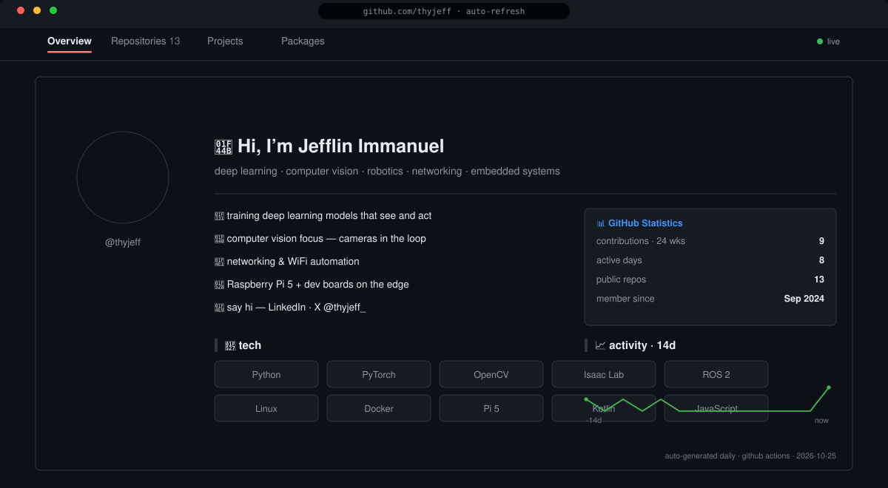

<p align="center">
  <picture>
    <source media="(prefers-color-scheme: light)" srcset="assets/dashboard-light.svg">
    
  </picture>
</p>

```python
>>> whoami()
'Jefflin Immanuel · @thyjeff'
>>> focus
['deep learning', 'computer vision', 'VLA / embodied AI',
 'networking', 'embedded systems']
>>> edge_fleet
['raspberry pi 5', 'assorted dev boards']
```

Deep learning × robotics — building vision-language-action systems and getting
them to run on real hardware. I train in simulation (Isaac Sim / Isaac Lab),
watch packets for fun, and make small boards do things they shouldn't.

---

### 🧠 currently training on

- **VLAs & foundation models for robots** — GR00T-style policies, VLM reasoning → motor actions
- **Sim2real** — Isaac Sim / Isaac Lab pipelines → exported policies on edge hardware
- **Computer vision** — detection, tracking, anything with a camera in the loop
- **Networking** — WiFi automation, captive-portal tooling, protocol tinkering
- **Embedded / edge AI** — Raspberry Pi 5 + dev boards as inference nodes

### 🦾 stack

`DL`     

`robotics`   

`systems`      

`edge`  

### ⚡ the console above

The dashboard at the top isn't a static image — it's a **self-updating animated SVG**:

- a 3D isometric contribution calendar in GitHub greens — blocks rise with daily push signal
- a minimal neural net accent with activations pulsing through
- language mix + edge fleet line (Pi 5 · dev boards · WiFi autologin)
- **regenerates itself daily** via [GitHub Actions](.github/workflows/metrics.yml) — `03:37 UTC`
- adapts to dark / light mode automatically

### 🔗 signal

[](https://www.linkedin.com/in/thyjeff/)
[](https://x.com/thyjeff_)
[](https://github.com/thyjeff)
